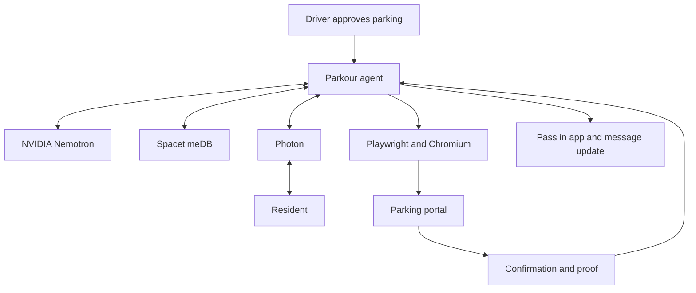

# Parkour

### You park. We handle the rest.

**Parkour is your personal parking registration agent.** It helps you register at supported parking locations by opening the guest portal, collecting missing information, coordinating with your host, and returning confirmation.

Built for **HackUTD Zero Day 2026**.

## Why Parkour?

Visiting a friend should not begin with a parking scavenger hunt. You find a visitor space, search for a QR code, open an unfamiliar portal, ask your friend for their apartment details, and fill out a form. Miss a step, and your car could be towed.

Parkour handles the coordination between the driver, the resident, and the parking portal so you can spend more time doing what you came for.

## The experience

1. **You tap yes.** Parkour recognizes arrival near a supported location and asks you to confirm where you are parking. Registration starts after your approval.
2. **The agent opens the guest portal.** A real Chromium browser navigates to the property's registration form.
3. **NVIDIA Nemotron identifies what is missing.** It interprets the form's questions and checks the available information, including saved resident details.
4. **Photon contacts the resident.** When more information is needed, Parkour asks your host for the relevant details.
5. **Nemotron interprets the reply.** Natural-language responses become validated, structured form fields.
6. **The agent completes registration.** It fills the portal, controls submission, and checks the result. CAPTCHA challenges return control to the user.
7. **You receive proof.** Your pass includes the available confirmation number, expiry information, and screenshots.
8. **Parkour remembers and reminds.** Saved details simplify future visits. Photon can send expiry reminders and accept a RENEW request where the parking rules allow an extension.

SpacetimeDB maintains shared registration state, saved details, proof metadata, and parking history throughout the workflow.

## Technology

| Component | Role |
| --- | --- |
| **NVIDIA Nemotron** | Interprets portal requirements and turns natural-language replies into structured information. |
| **Photon Spectrum** | Carries resident requests, incoming replies, registration updates, and reminders. The current messenger integration uses iMessage. |
| **SpacetimeDB** | Stores accounts, vehicles, saved places, registration state, and history. Reducers enforce business rules and state transitions. |
| **Playwright + Chromium** | Opens portals, interacts with forms, submits registrations, and captures evidence. |
| **Flutter** | Provides the user experience for arrival prompts, vehicle profiles, registration progress, and passes. |
| **Python backend** | Coordinates browser execution, model calls, messaging, and access to the state store. |

### Architecture



### How the pieces connect

- **Nemotron understands the information.** It helps map form requirements and resident replies into data the workflow can use. Structured outputs are validated before execution.
- **Photon reaches the person who has the answer.** The resident's response returns to the registration workflow, allowing a paused task to continue.
- **SpacetimeDB preserves context.** Registration state remains available while the agent waits for information, executes the browser workflow, or records the result.
- **The browser agent acts on the portal.** A registration is reported as confirmed after the portal returns a recognized result, with evidence saved for the user.

## Scope

Parkour is a hackathon MVP for selected parking locations. The workflow above describes the product architecture and intended experience; individual portal paths may use tested, property-specific adapters or AI-assisted form interpretation. Universal portal coverage and precise identification of every parking lot are expansion goals.

The initial experience includes the Maverick Place guest-registration flow. Additional demo portals support development and testing without requiring a real parking submission.

## User control and safeguards

- **Explicit approval:** registration begins after the user agrees.
- **Approved domains:** browser navigation is restricted to supported destinations.
- **Validated data:** structured model outputs are checked before use; form plans restrict selectors and values.
- **Controlled submission:** execution is coordinated through registration state and worker claims to reduce accidental duplicate actions.
- **Human handoff:** CAPTCHA challenges and unresolved blockers return control to the user.
- **Resident controls:** residents can decline a request, and messaging requests are rate-limited.
- **Confirmation evidence:** passes retain the available confirmation, expiry, and screenshot references.

Renewal depends on the property's rules and a successful new registration. Arrival detection alone does not establish permission to park.

## Run locally

The commands below use a Bash environment, such as macOS, Linux, or WSL on Windows.

### Prerequisites

- Python 3 with `venv` and `pip`.
- Node.js and npm. The messenger specifies Node.js 18.17 or newer.
- Flutter SDK with web support, or an Android/iOS development environment.
- SpacetimeDB CLI and the prerequisites required to publish its TypeScript module.
- NVIDIA API credentials for live model inference.
- Photon project credentials and paired participants for live iMessage communication.

### 1. Clone and install dependencies

```bash
git clone https://github.com/soumiksen/hackutd-2026.git
cd hackutd-2026
cp .env.example .env

python3 -m venv .venv
source .venv/bin/activate
pip install -r requirements.txt
python -m playwright install chromium

npm ci --prefix messenger
npm ci --prefix spacetimedb

cd app
flutter pub get
flutter build web
cd ..
```

### 2. Configure credentials

Edit the repository-root `.env` using `.env.example` as the reference.

| Variable | Purpose |
| --- | --- |
| `NVIDIA_API_KEY` | Authenticates live requests to NVIDIA's model endpoint. |
| `NEMOTRON_MODEL` | Chooses the Nemotron model available to your project. |
| `SPACETIMEDB_URI` | SpacetimeDB server URL; local development defaults to `http://127.0.0.1:3000`. |
| `SPACETIMEDB_DATABASE` | Database name; defaults to `parkour`. |
| `SPACETIMEDB_TOKEN` | Token for the identity that owns and publishes the module. |
| `PHOTON_PROJECT_ID` / `PHOTON_PROJECT_SECRET` | Authenticate the Photon messenger. |
| `INTERNAL_API_KEY` | Shared secret for communication between the backend and messenger. |
| `BACKEND_URL` / `MESSENGER_URL` | Local service addresses; normally ports `8000` and `8790`. |
| `PHOTON_INBOUND` | `stream` receives replies over Spectrum's connection. |
| `PHOTON_WEBHOOK_SECRET` | Required if using the alternative signed webhook route. |
| `VISION_MODEL` | Optional model configuration for the separate photo-understanding features. |
| `REQUIRE_AUTH` | Set to `true` when exposing the backend to other devices or a shared network. |

Use a strong value for `INTERNAL_API_KEY`. Keep credentials in `.env`, never in client code or committed files. Add or pair every demo participant, including the resident, in Photon before testing live messages.

### 3. Prepare SpacetimeDB

Follow the [SpacetimeDB installation instructions](https://spacetimedb.com/docs/) to install the CLI. Select the local server and start it in a terminal:

```bash
spacetime server set-default local
spacetime start
```

In another terminal, publish the module:

```bash
spacetime publish parkour --module-path spacetimedb --server local
spacetime login show --token
```

Copy the owner token into `SPACETIMEDB_TOKEN` in `.env`.

### 4. Start the demo

From the repository root:

```bash
bash scripts/dev.sh --web --messenger
```

The script starts the backend and browser worker, serves the mock portal, publishes the database module, and optionally starts the Flutter web server and Photon messenger.

| Service | Local address |
| --- | --- |
| Flutter web app | `http://127.0.0.1:8080` |
| Backend API | `http://127.0.0.1:8000` |
| Demo parking portal | `http://127.0.0.1:8001` |
| Photon messenger | `http://127.0.0.1:8790` |
| SpacetimeDB | `http://127.0.0.1:3000` |

Omit `--messenger` to start the stack without the live messaging service. Resident text exchanges require that service and its credentials.

For a physical phone, see [`app/README.md`](app/README.md) and the script's `--lan` option. Native arrival behavior and permissions differ from the browser demo.

## Demo walkthrough

1. Create a profile, add your vehicle, and enable registration consent.
2. Select a supported property or use the app's simulated-arrival option.
3. Approve the registration.
4. If resident details are missing, provide your host's paired phone number.
5. Have the resident reply with their unit number and last name.
6. Follow the registration progress and complete any requested human checks.
7. Open the resulting pass and inspect its confirmation and proof.

Use the mock portals for repeatable testing. A real portal submission creates a real parking registration.

## Repository guide

| Path | Contents |
| --- | --- |
| [`app/`](app/) | Flutter client. |
| [`agent/`](agent/) | Backend, orchestration, browser execution, model integration, and tests. |
| [`messenger/`](messenger/) | Photon Spectrum TypeScript service. |
| [`spacetimedb/`](spacetimedb/) | Tables, reducers, and registration state machine. |
| [`data/`](data/) | Supported property data, vendor configuration, and allowed domains. |
| [`mock-portal/`](mock-portal/) | Demo parking portals. |
| [`scripts/dev.sh`](scripts/dev.sh) | Local stack launcher. |
| [`deploy/`](deploy/) | Deployment configuration and instructions. |
| [`API_CONTRACT.md`](API_CONTRACT.md) | API request and response contract. |

## Development checks

With the virtual environment active and a local SpacetimeDB server available:

```bash
pytest
```

The database tests use a separate `parkour-test` database. See [`spacetimedb/README.md`](spacetimedb/README.md) for test isolation and module setup.

Check the database module's TypeScript types:

```bash
cd spacetimedb
npm run typecheck
```

## What we learned

Useful agents need to recognize missing information, coordinate with people, interact with external systems, and establish whether the task succeeded. Persistent state connects those actions, while validation and human handoffs keep users in control.

## What's next

- **December 2026 pilot:** launch with selected student housing communities near UTA and UTD to validate demand, registration reliability, and repeat usage.
- **Founder-led onboarding:** personally verify the first properties and their registration workflows.
- **DFW expansion:** grow through resident referrals, campus organizations, and housing partnerships.
- **Location improvements:** add more precise lot recognition and directions to visitor parking.
- **Broader coverage:** support more public and private lots requiring registration, using community suggestions to identify new locations.
- **Startup development:** apply to NVIDIA Inception and continue building Parkour beyond HackUTD.

These are planned milestones and application goals, rather than announced partnerships or program acceptance.

**Your plans shouldn't revolve around parking.**
